<div align="center">


# ConformUI

**Check AI-built pages against the design, with on-device Gemini Nano 4 (Gemma 4) and cloud Gemini.**

Hybrid on-device and cloud AI through Firebase AI Logic, in one installable, offline-ready PWA with a single codebase.

[](LICENSE)
[](https://github.com/qmamushroof/ConformUI/actions/workflows/ci.yml)
[](https://conformui.web.app)
[](#platforms)
[](#on-device-ai-gemini-nano-4)
[](#architecture)

**[Live app](https://conformui.web.app)** · <!-- VIDEO_URL --> **[Quick start](#quick-start)** · **[On-device AI](#on-device-ai-gemini-nano-4)** · **[Screenshots](#screenshots)** · **[Docs](docs/)**

<br>

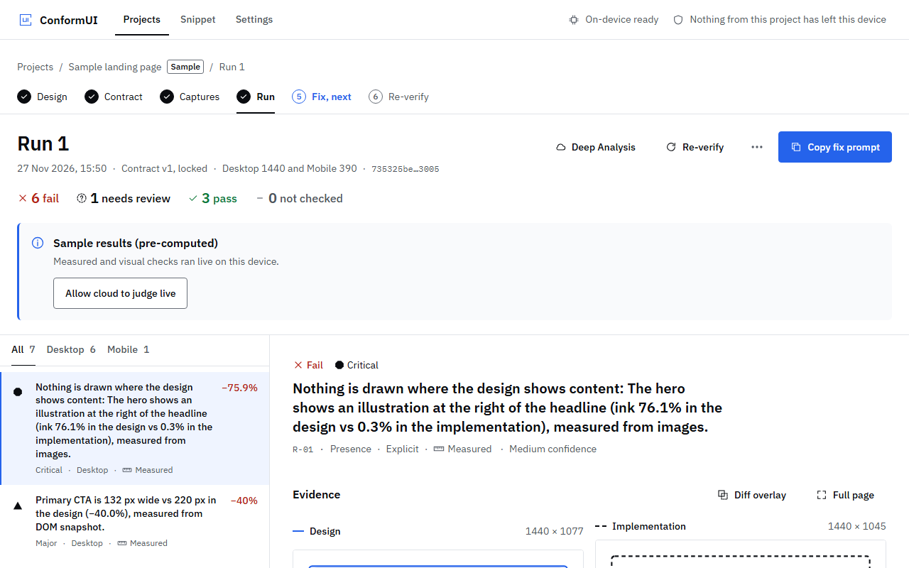
&nbsp;
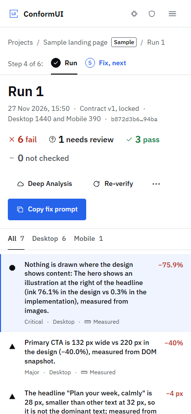

</div>

ConformUI is built for the #BuildHybridAI 2026 hackathon on the Web/Chrome platform. It turns a design into a checkable contract, measures a page against it, and hands the failures back to your coding agent. One installable PWA with a single codebase runs in modern desktop and mobile browsers and works offline. On-device AI runs in desktop Chrome; everywhere else the same app runs on cloud Gemini automatically.

## Contents

- [The problem and the value](#the-problem-and-the-value)
- [What it does](#what-it-does)
- [How Firebase AI Logic is used](#how-firebase-ai-logic-is-used)
- [On-device AI (Gemini Nano 4)](#on-device-ai-gemini-nano-4)
- [Hybrid strategy](#hybrid-strategy)
- [Platforms](#platforms)
- [Screenshots](#screenshots)
- [Test it as a judge](#test-it-as-a-judge)
- [Quick start](#quick-start) and [Setup](#setup)
- [Enabling on-device AI in Chrome](#enabling-on-device-ai-in-chrome)
- [Architecture](#architecture) and [Tests](#tests)
- [Privacy](#privacy), [Built during the hackathon](#built-during-the-hackathon) and [License](#license)

## The problem and the value

AI coding agents build pages fast, and the pages drift from the design. Spacing is off, a heading is the wrong size, a section is missing on mobile. Checking by eye is slow and misses small deviations. Asking a model "does this match?" gives an opinion, not evidence.

ConformUI turns the design into a checklist you can lock. It measures the page against that list with a deterministic engine. It writes each failure as a prompt your coding agent can act on. You get numbers you can trust, a short list of what to fix, and a way to prove the fix worked. The first AI pass runs on device with Gemini Nano 4 (Gemma 4), so your designs stay private and the pass is free and works offline. The cloud adds depth only when you ask. It needs no account and no backend, and it is free to try.

## What it does

ConformUI answers one question: "Does this implementation satisfy the design it was meant to implement?" It is an installable web app (PWA) with no backend and no account. It is not a chatbot and not a visual-regression tool.

1. You add a design reference (an image) and an implementation capture (a screenshot, plus an optional DOM snapshot) for each viewport, Desktop and Mobile.
2. The first pass extracts a Design Acceptance Contract (the Contract): a list of Requirements, each labelled Explicit or Inferred and each with a check type of Measured, Visual or Judged. You review, edit and lock it.
3. A Run checks the Contract against the captures. Each Requirement ends as Pass, Fail, Needs review or Not checked, and each failure becomes a Finding with Evidence (design and implementation crops, a diff overlay, measured deltas), a severity of Critical, Major or Minor, a confidence of High, Medium or Low, a suggested fix and a verification condition.
4. You copy a Fix prompt for your coding agent, fix the page, and Re-verify. Each Requirement then shows Resolved, Remaining, New, Regressed or Still passing.

Every number comes from a deterministic engine, never from a model. Models only extract, judge and, on request, deepen the analysis.

## How Firebase AI Logic is used

All model calls go through the Firebase AI Logic web SDK (`firebase/ai`) using hybrid inference with the Gemini Developer API. The code that calls AI Logic is in [`src/platform/ai-engine/`](src/platform/ai-engine/); nothing else in the app imports the AI SDK.

### InferenceMode per feature

| Feature | InferenceMode | When |
|---|---|---|
| First pass (Contract extraction, Judged checks, Inferred responsive expectations) before cloud consent | `ONLY_ON_DEVICE` | Auto mode, on-device model already available |
| First pass after the Project has cloud consent | `PREFER_ON_DEVICE` | Auto mode, after "Use cloud for this project" |
| First pass in Cloud only mode | `ONLY_IN_CLOUD` | Setting chosen by the user, after Project consent |
| Deep Analysis | `ONLY_IN_CLOUD` | Explicit button, after the confirm sheet |

### Where the code is

These files import and call `firebase/ai` at runtime:

- [`src/platform/ai-engine/model-factory.ts`](src/platform/ai-engine/model-factory.ts): `getAI`, `getGenerativeModel` and the `InferenceMode` mapping.
- [`src/platform/ai-engine/run.ts`](src/platform/ai-engine/run.ts): runs a request, reads `inferenceSource`, retries and validates.
- [`src/platform/ai-engine/status.ts`](src/platform/ai-engine/status.ts): on-device availability and model download.
- [`src/platform/ai-engine/schema-for.ts`](src/platform/ai-engine/schema-for.ts): builds the response schemas from the zod types.
- [`src/platform/ai-engine/index.ts`](src/platform/ai-engine/index.ts): the public API of the module.

The mode and consent rules are pure code in [`src/shared/kernel/consent.ts`](src/shared/kernel/consent.ts). An excerpt from `model-factory.ts`:

```ts
let params: HybridParams;
if (spec.mode === 'ONLY_ON_DEVICE') {
  params = { mode: InferenceMode.ONLY_ON_DEVICE, onDeviceParams };
} else if (spec.mode === 'PREFER_ON_DEVICE') {
  params = { mode: InferenceMode.PREFER_ON_DEVICE, onDeviceParams, inCloudParams };
} else {
  params = { mode: InferenceMode.ONLY_IN_CLOUD, inCloudParams };
}
ai ??= getAI(d.app, { backend: new GoogleAIBackend() });
return getGenerativeModel(ai, params);
```

### Details

- **`inferenceSource` badge.** Every AI output stores and shows the Engine that produced it, read from the SDK's reported `inferenceSource` (`InferenceSource.ON_DEVICE` or `InferenceSource.IN_CLOUD`). Measured outputs are labelled Measured. The Engine trace shows the bytes sent to the cloud, which is 0 for on-device calls.
- **Structured output validated by zod.** Each call is one task with one schema. The schema is passed to the SDK (`responseConstraint` on device, `responseSchema` in the cloud) and the result is validated again with zod. Invalid output is retried once, then the item is marked Needs review. Raw model text is never shown as a result. Numbers in model text are checked against engine measurements and replaced by a deterministic template if they do not match.
- **Consent-safe mode mapping.** One pure function, `resolveMode`, picks the mode, and the adapter guards it again. Before consent only `ONLY_ON_DEVICE` can be used; the `PREFER_*` modes are never used before consent because they fall back to the cloud silently. A cloud-capable call needs a consent token that can only be minted from a user click. When the device cannot answer, the app asks once per Project instead of calling.
- **App Check.** Cloud calls are protected with App Check: reCAPTCHA Enterprise on the hosted domain, the debug provider on localhost only. App Check is enforced for AI Logic.
- **Remote Config keys.** Model names, thresholds and flags come from Remote Config with bundled defaults, so the app works offline. The keys, with defaults, live in [`remoteconfig.template.json`](remoteconfig.template.json): `cloud_first_pass_model`, `deep_model`, `on_device_timeout_s`, `cloud_timeout_s`, `prompt_version`, `cloud_enabled`, `deep_daily_cap`, `feature_ai_infer_responsive`, `size_tolerance_pct`, `major_deviation_pct`, `spacing_tolerance_pct`, `pixel_threshold`, `visual_diff_ratio`, `presence_ink_ratio`, `colour_delta_e`, `snap_min_iou`, `search_window_px`, `width_mismatch_pct`.

## On-device AI (Gemini Nano 4)

ConformUI runs its first AI pass on the device. On-device inference runs Gemma 4 through Chrome's built-in AI (the Prompt API, enabled with `#gemma4-for-built-in-ai`; Chrome downloads `gemma4_component`), and Firebase AI Logic hybrid inference calls it. Google describes Gemma 4 as the foundation for Gemini Nano 4, so the app targets the Gemini Nano 4 generation on-device. The Android Developers blog post [Announcing Gemma 4 in the AICore Developer Preview](https://developer.android.com/blog/posts/announcing-gemma-4-in-the-ai-core-developer-preview) (2 April 2026) says: "These models are the foundation for the next generation of Gemini Nano, so code you write today for Gemma 4 will automatically work on Gemini Nano 4-enabled devices". That post is about Android AICore and does not mention Chrome. The cloud Gemini model is the fallback and the deeper pass.

How the hybrid mode works:

- **Prefer on-device.** In Auto mode the first pass uses `ONLY_ON_DEVICE` before consent and `PREFER_ON_DEVICE` after you allow the cloud for a Project. Measured and Visual checks never use a model.
- **Cloud fallback, Gemini.** When the device cannot answer, the app asks once per Project and then uses `ONLY_IN_CLOUD` or the `PREFER_ON_DEVICE` fallback. Deep Analysis always uses the cloud, after a confirm sheet.
- **Timeouts from Remote Config.** `on_device_timeout_s` and `cloud_timeout_s` set how long each side may take. Model names and thresholds also come from Remote Config, with bundled defaults for offline use.
- **Offline and model unavailable.** Offline, the on-device pass still works and cloud steps wait with a plain message. If the model is missing, downloading or lacks image input, the header chip and Settings say so, and the cloud path is offered with consent. Nothing is called silently.
- **Mode indicator.** The header chip (for example "On-device ready"), the Engine panel in Settings, and a label on every AI result say which engine answered: On-device, Cloud or Measured.

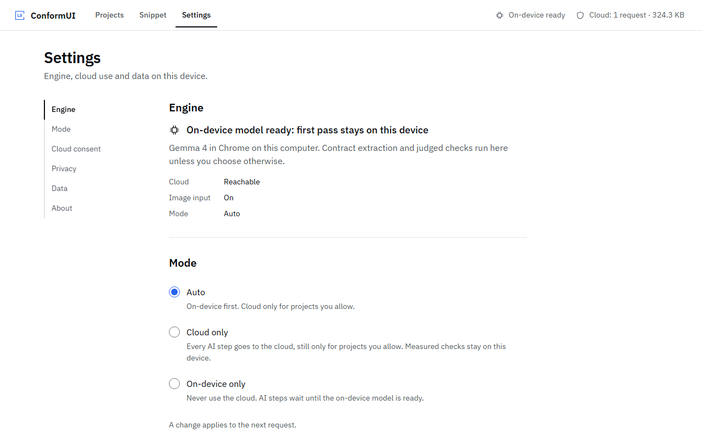

This screenshot was taken with the app's test build, where a fake engine reports "on-device ready". It shows the real interface and the real mode indicator, but it is not a capture of live Gemini Nano 4 output. Live on-device runs are recorded in the Verify checklist below and in the demo video.

To turn it on, follow [Enabling on-device AI in Chrome](#enabling-on-device-ai-in-chrome).

## Hybrid strategy

| Situation | What happens |
|---|---|
| On-device model ready | The first pass runs on the device. Nothing leaves the machine. The badge says On-device. |
| Model missing, downloading or without image input | The app asks once per Project whether to use the cloud. It never calls the cloud before you say yes. |
| Cloud consent granted | Auto mode uses `PREFER_ON_DEVICE`: the device answers when it can and the cloud answers when it cannot. The badge shows which one did. |
| Deep Analysis | Always cloud, and only after you confirm a sheet that lists what is sent. |
| Offline | The app shell, the sample and saved Projects open. The on-device first pass still works. Cloud steps are off with a plain message, and your results are kept. |
| Errors | Quota, App Check, timeout and invalid output each show a plain message. Invalid output is retried once, then the item is marked Needs review. Raw model text is never shown. |
| Badge | Every AI output shows the Engine that made it (On-device, Cloud or Measured), taken from the SDK's `inferenceSource`. |

Measured and Visual checks never use a model, so they run the same in every case.

## The three engines

| Engine | What it is | Strength |
|---|---|---|
| On-device | Gemini Nano 4 (Gemma 4, Chrome built-in AI, enabled by `#gemma4-for-built-in-ai`) in desktop Chrome, through AI Logic hybrid inference | Private, free, works offline |
| Cloud | Gemini through Firebase AI Logic | More capable reasoning, works in any browser |
| Measured | Deterministic TypeScript engine: region snapping, image and region diff, geometry, DOM snapshot measurements | Exact and reproducible |

## Features and value

- **Projects** stored locally in IndexedDB. Your designs stay on your machine unless you choose the cloud.
- **Inputs** per viewport: design references and implementation captures (PNG, JPEG or WebP), plus an optional DOM snapshot.
- **DOM snippet**: a script you copy from the app and run on your own page. It reads element boxes, text and key computed styles, and sends nothing over the network.
- **Design Acceptance Contract** with Explicit and Inferred Requirements across the categories Presence, Content, Position/alignment, Size, Spacing, Typography hierarchy, Colour and Responsive.
- **Verification Run** with per-Requirement status and an Engine trace.
- **Findings and Evidence** with severity, confidence, a suggested fix and a verification condition.
- **Deep Analysis**: an explicit, cloud-only pass that resolves Needs review items and explains causes across viewports.
- **Re-verify** against the same Contract.
- **Exports**: a Fix prompt for a coding agent, and the Contract and report as Markdown and JSON.
- **Demo sample**: one click opens a sample Project with planted defects.
- **Engine status and settings**: model readiness, enable steps, mode, cloud consent, a privacy counter and data deletion.
- **Version and source**: Settings > About shows the version (1.0.1) and links to this repository.
- **Installable and offline**: the app shell and the sample open offline.

## Platforms

One codebase, one installable PWA. The layout adapts from phone to desktop. Deterministic measurements, Contracts, local storage and exports run on the device on every platform.

| Platform | Install | On-device AI (Gemini Nano 4 / Gemma 4) | Cloud Gemini | Smoke test |
|---|---|---|---|---|
| Chrome on desktop (Windows, macOS, Linux, ChromeOS) | Install from the address bar | Yes, with built-in AI enabled | Yes, after consent, labelled Cloud | Chromium, desktop |
| Firefox on desktop | Runs in the browser | Not used | Automatic after consent, labelled Cloud | Firefox, desktop |
| Safari on desktop (macOS) | Runs in the browser | Not used | Automatic after consent, labelled Cloud | WebKit / Safari, desktop |
| Chrome on Android | Install or Add to Home screen | Not used | Automatic after consent, labelled Cloud | Pixel 7 viewport (emulated) |
| Safari on iPhone | Add to Home Screen | Not used | Automatic after consent, labelled Cloud | iPhone 14, iOS-emulated |

Tested with Playwright on Chromium, WebKit / Safari and Firefox at desktop size, plus Pixel 7 and iPhone 14 (iOS-emulated) viewports: load, sample project, Run, Findings, Settings, manifest and service worker (`npm run test:cross`). The app shell and the sample open offline.

Where on-device AI is not available, the same Firebase AI Logic hybrid call uses cloud Gemini after the person consents, and every AI result is labelled Cloud.

## Screenshots

Captured from the sample project with `npm run screenshots` (see [scripts/capture-screenshots.mjs](scripts/capture-screenshots.mjs)). They use the app build with a fake AI engine, so they need no network and show no keys or personal data. Run the script again after a UI change.

### Projects and Contract

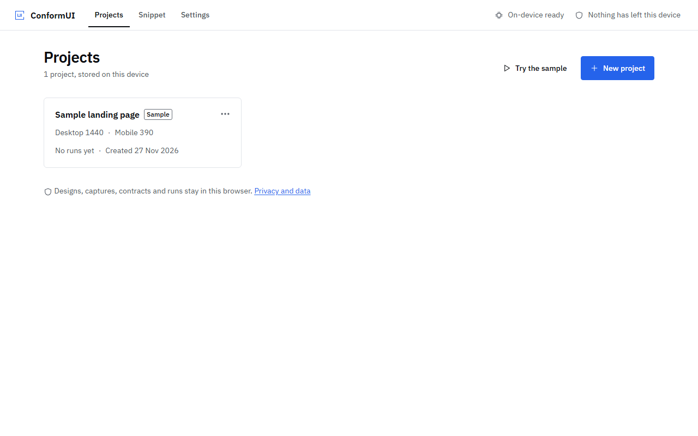

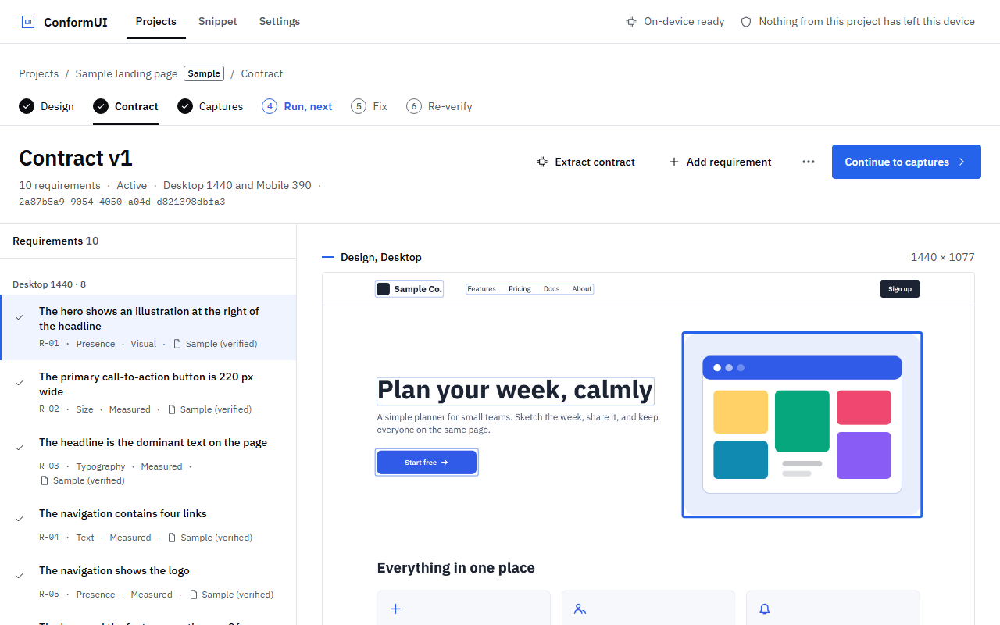

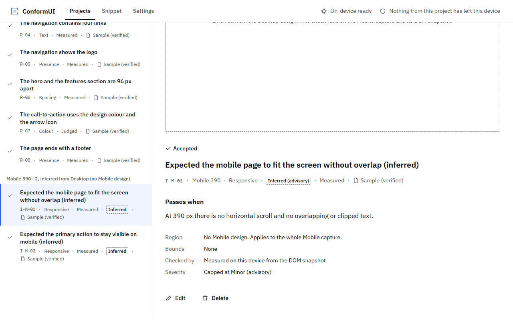

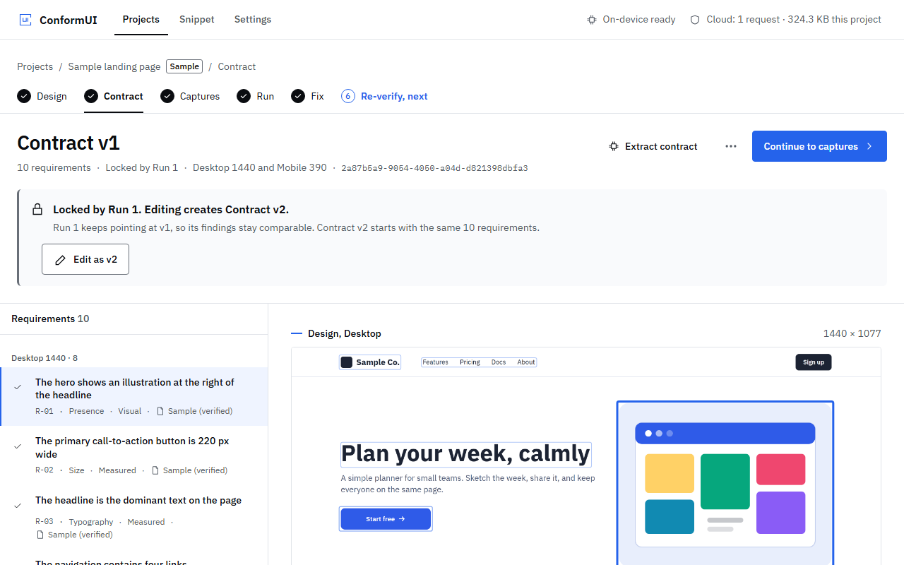

### Run, Findings and Evidence


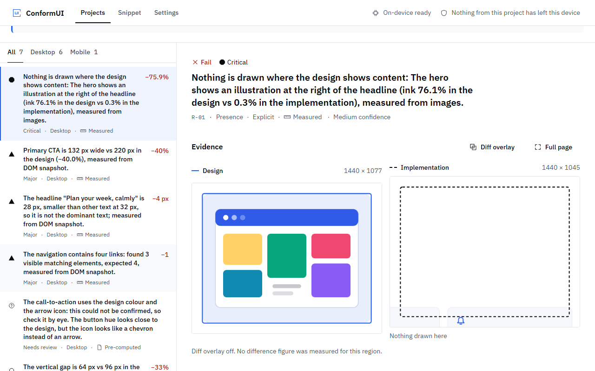

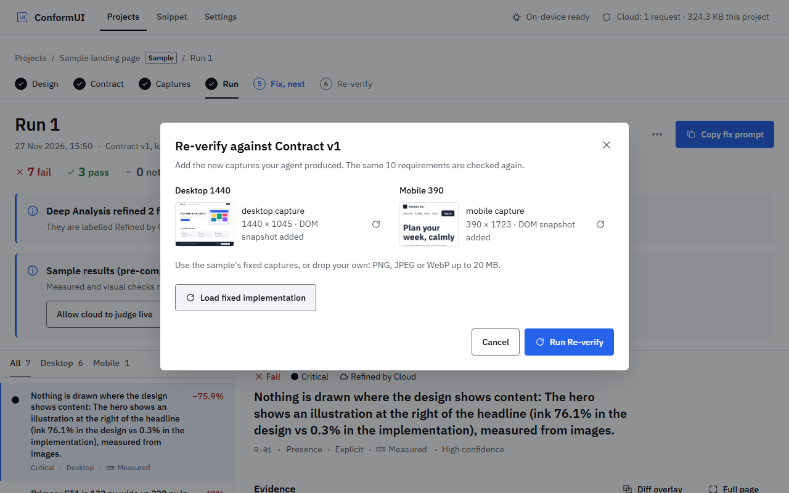

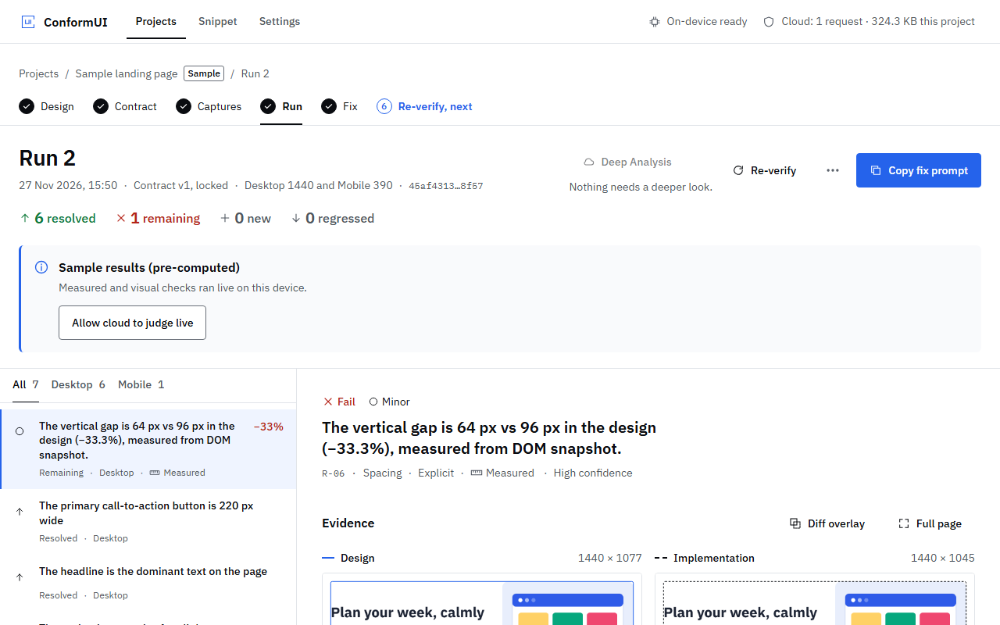

### Deep Analysis and export

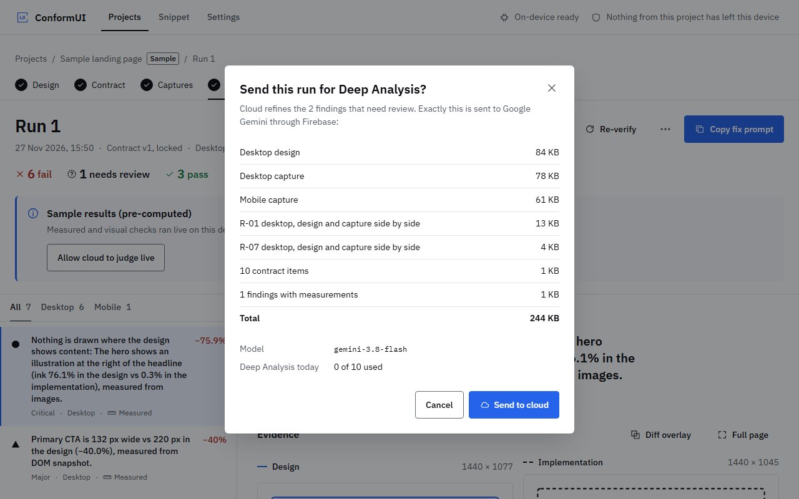

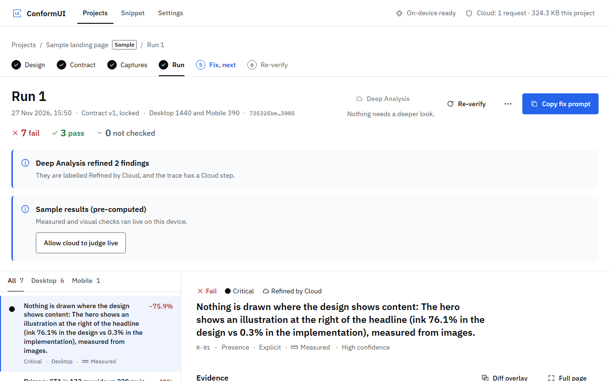

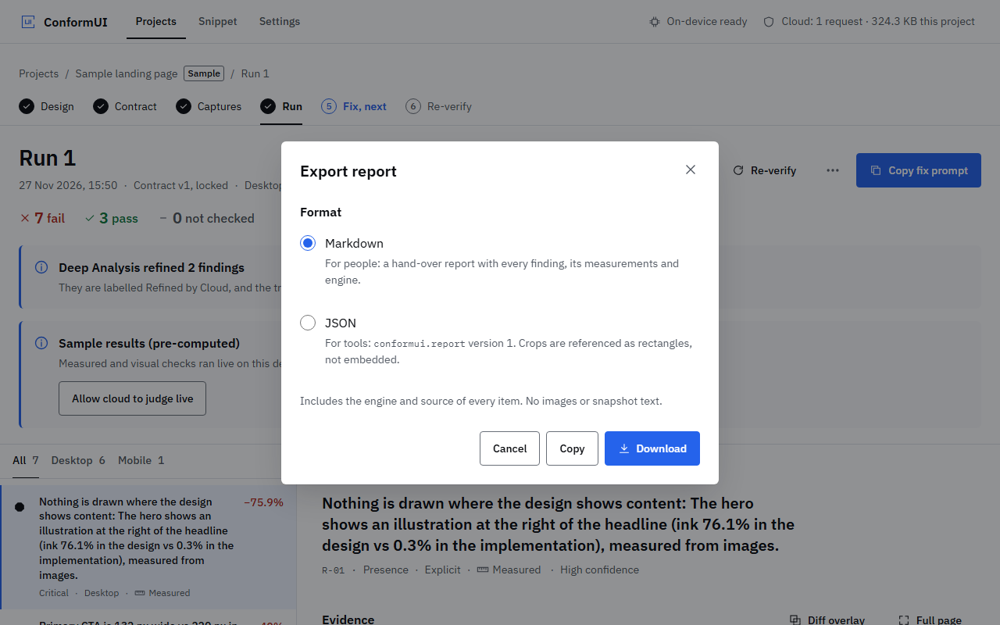

### Engine, settings and offline


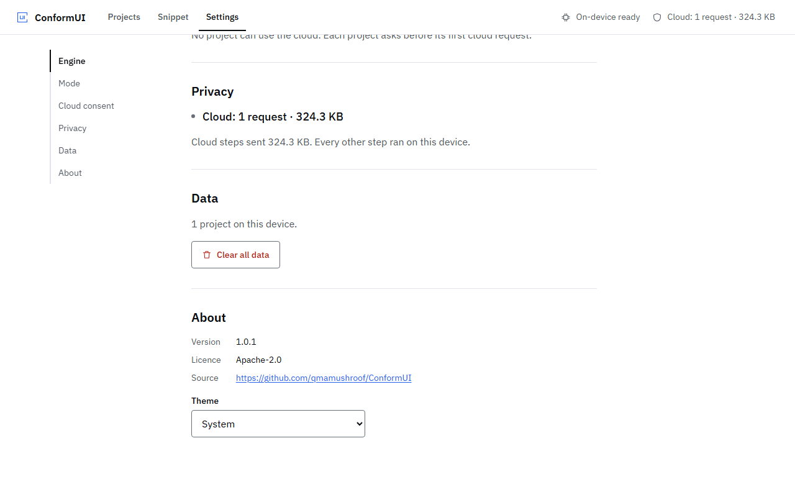

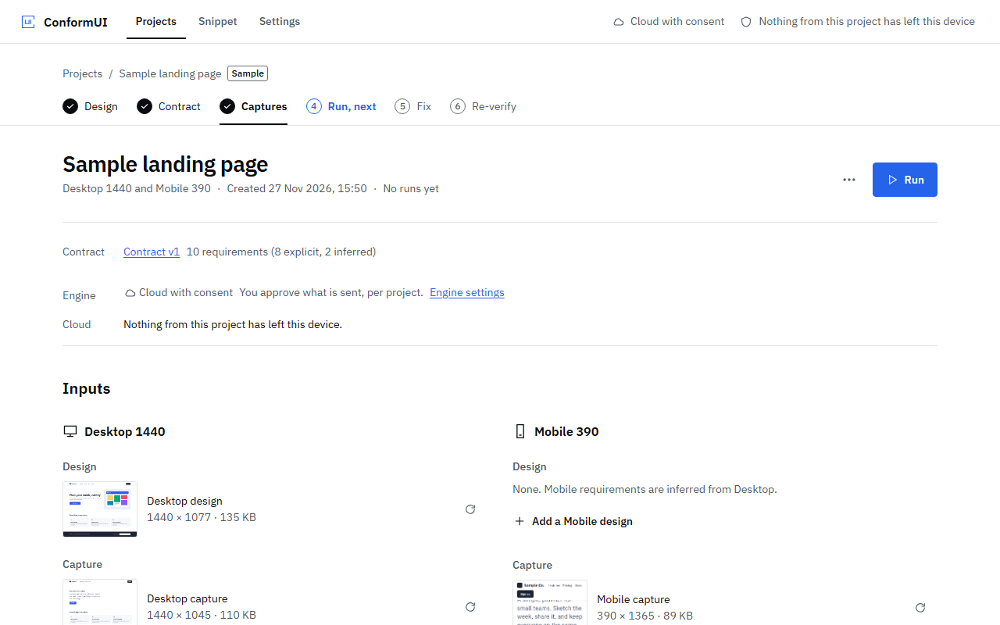

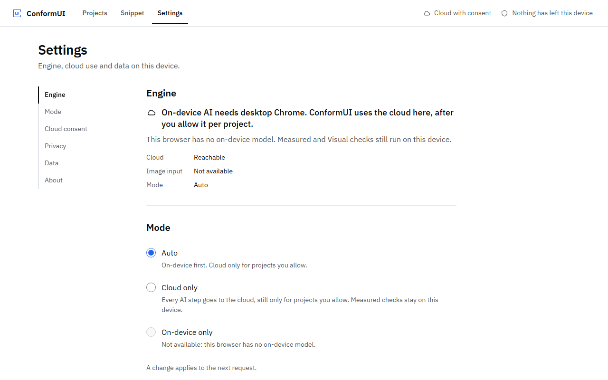

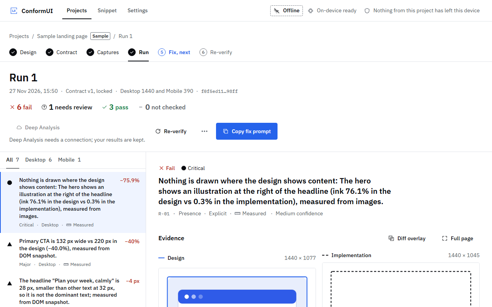

### Mobile (390 x 844)

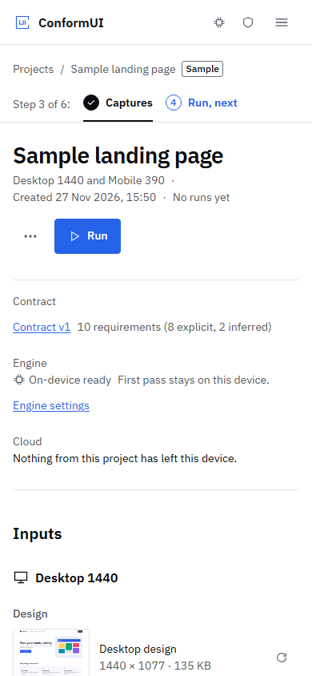


## Test it as a judge

No login, no payment and no install are needed. Use desktop Chrome for the full hybrid experience. Other browsers use the cloud path after consent.

Quickest path, the sample project:

1. Open https://conformui.web.app. You land on the welcome page.
2. Click **Try the sample**. A sample landing page Project opens with its Contract.
3. Click **Run**. The deterministic engine measures the sample's captures and shows Findings with Evidence, severity and a suggested fix.
4. Open a Finding to see the design and implementation crops and the measured numbers. The Engine pill in the header, and Settings, show which engine is active.
5. Click **Copy fix prompt** to get the prompt for a coding agent. Use **Re-verify** to check the fixed captures against the same Contract.
6. Open **Deep Analysis** and confirm the sheet to run the cloud pass. It shows the Cloud badge and what was sent.

With your own design:

1. Click **Start a project** and name it. Add a design image and an implementation screenshot for Desktop (PNG, JPEG or WebP, up to 20 MB). Add a Mobile pair if you like. Optional: copy the DOM snippet from the app, run it on your page and add its output.
2. Click **Extract contract**. If the on-device model is ready this runs locally. Otherwise the app asks for cloud consent for this Project.
3. Review the Requirements (accept, edit or reject), lock the Contract and click **Run**.
4. Fix what the Findings say, replace the capture and **Re-verify**.

To see the on-device path, enable the Chrome flags in [Enabling on-device AI in Chrome](#enabling-on-device-ai-in-chrome) and use **Download model** in Settings.

## Quick start

Requires Node 26 or newer.

```
npm ci
cp .env.example .env.local
npm run dev
```

Fill `.env.local` with your Firebase web config and App Check values; the variables are listed in `.env.example`. The dev server runs at http://localhost:5173 (the port matters: the API key referrer list contains it). Other scripts: `npm run build`, `npm run preview`, `npm run check:fast` (lint, types, dependency rules, unit and component tests) and `npm run check` (adds the build, size checks and end-to-end tests with a fake AI engine).

## Setup

One-time steps for your own Firebase project (details in [docs/SETUP.md](docs/SETUP.md)):

1. Create the Firebase project, enable **AI Logic** with the Gemini Developer API, and keep AI monitoring off.
2. Register the Web app, create a score-based reCAPTCHA Enterprise Web key for the Hosting domains, register it in App Check, enforce App Check for AI Logic, and register dev debug tokens before first run. Add each Hosting preview channel host to the key domains and the API key referrers before testing on it.
3. Publish Remote Config from `remoteconfig.template.json`, either by console import or `npx firebase deploy --only remoteconfig`.
4. Restrict the API key by referrer. On the Spark plan the default AI Logic per-user quota is kept; if you upgrade to Blaze, set a budget alert and quotas.
5. Record the hosted URL (the Hosting default domain, https://conformui.web.app for this project) after the first deploy.

## Enabling on-device AI in Chrome

On-device inference runs Gemini Nano 4 (Gemma 4) through Chrome's built-in AI (Prompt API). It needs desktop Chrome 139 or newer. Older Chrome builds ship the previous Nano v3 by default; enable the flag to get Gemma 4. Steps for judges:

1. Update desktop Chrome to version 139 or newer (the project was verified on Chrome 158).
2. Open `chrome://flags`, set `#gemma4-for-built-in-ai` and `#prompt-api-multimodal-input` to Enabled, and relaunch Chrome.
3. Open https://conformui.web.app, go to Settings and press **Download model**. The download needs a click and can take several minutes (about 2 GB, once). The header chip changes to "On-device ready".
4. To confirm Gemma 4 answers, open `chrome://on-device-internals`, go to Event Logs before prompting, then run a prompt in the app (for example **Extract contract** on a new Project). You should see "Loading model [gemma4_gpu_high_tier_model] on backend [GPU]".

The app detects a missing flag or API and shows these steps. Chrome decides which model variant runs; a page cannot choose. On an older Chrome the multimodal flag is named `#prompt-api-for-gemini-nano-multimodal-input`. Hardware needs and the full steps are in [docs/SETUP.md](docs/SETUP.md), section C.

If on-device AI is unavailable (other browser, no flag, not enough disk or GPU, model not downloaded), you will see "On-device unavailable" in the header chip and the Engine panel, with the steps above. The app still works. Measured and Visual checks run in full and the sample opens with its stored results. AI steps offer the cloud after you consent for the Project, and every cloud result is labelled Cloud. In On-device only mode the AI steps stay off and say why.

## Architecture

The app is a React 19 and TypeScript PWA with no backend. The code is split into modules with enforced dependency rules (dependency-cruiser and architecture tests in CI):

- `src/shared/kernel`: types, zod schemas, errors, consent and mode rules. It has no dependencies.
- `src/platform`: adapters for `firebase`, `ai-engine`, `storage` (IndexedDB) and `imaging`.
- `src/features`: `measure`, `dom-snippet`, `demo`, `contract`, `run`, `deep-analysis`, `export`, `projects` and `settings`. Features use the kernel and ports. They do not use each other's internals or the app.
- `src/app`: the composition root, routes, service worker and copy.

The design documents are [docs/PRD.md](docs/PRD.md), [docs/SPEC.md](docs/SPEC.md) and [docs/ROADMAP.md](docs/ROADMAP.md).

## Tests

- Unit and component tests with Vitest: `npm test`. They cover the kernel, the measure engine, the AI engine adapter, Run, Contract, storage and every screen.
- Architecture tests in [tests/architecture](tests/architecture).
- End-to-end tests with Playwright, run against a build with a fake AI engine so CI needs no secrets: `npm run test:e2e`. They cover the two-click sample flow, offline, consent, PWA install, keyboard use and axe accessibility checks.
- A smoke test of the production build: `npm run test:prod`.
- `npm run check` runs lint, types, dependency rules, tests, build, size and dist checks.

## Tested browsers

- Desktop Chrome 158 on Windows: on-device and cloud paths.
- Chromium, WebKit / Safari, Firefox, a Pixel 7 viewport and an iPhone 14 (iOS-emulated) viewport: cross-browser smoke test with Playwright (`npm run test:cross`).
- Other browsers run on cloud Gemini after consent.

## Deploy

Deploys are manual from a developer machine; there is no deploy workflow.

```
npm ci && npm run build && npx firebase deploy --only hosting
```

A preview channel is available with `npx firebase hosting:channel:deploy preview --expires 7d`. Hosting serves an enforced Content Security Policy (proven with zero violations on the production host).

## Verify checklist

Results were recorded on the hosted app at https://conformui.web.app. Rows marked pending need a desktop Chrome with on-device Gemma and are recorded by the owner.

| Check | Result |
|---|---|
| Hosted URL loads over HTTPS and installs on desktop Chrome | Loads over HTTPS (HTTP 200, HSTS, nosniff, no-referrer); offline second visit opens the shell and the sample; install on desktop Chrome pending |
| Sample Extract (On-device), Run, Deep Analysis (Cloud), Copy fix prompt, Re-verify, export | pending |
| Both `inferenceSource` values seen; App Check accepted (no 401 or 403) | App Check accepted, no 401 or 403, cloud inferenceSource seen (Gemini through AI Logic); on-device value pending |
| Offline first pass with the network off (on-device) | pending |
| Deterministic Run stages for the sample, 2 viewports, within 3 s | pending |
| On-device Contract extraction under 60 s | pending |
| AI extraction covers at least 4 of the 6 measurable planted defects (Engine reported) | pending |
| Zero CSP violations on Hosting for one Deep Analysis and one on-device image prompt | Enforced CSP: zero violations for the sample flow, cloud Extract and Deep Analysis send; on-device image prompt pending |
| Lighthouse scores on the preview (advisory) | Production host: performance 88, accessibility 95, best practices 77, SEO 91; bundle size check passes |

## Demo video

<!-- VIDEO_URL -->

The demo shows the sample project end to end in under three minutes: on-device first pass, Run, Findings, Deep Analysis and Re-verify.

## Honest limits

- On-device inference runs in desktop Chrome with built-in AI. Everywhere else the same app runs on cloud Gemini automatically, after consent.
- On-device calls are single-turn with a small token limit, and images are downscaled before sending.
- The model version on device is chosen by Chrome, not by the app.
- The sample's pre-computed results are hand-authored.
- Judged checks are model opinions labelled with Engine and confidence; only Measured and Visual checks are exact.

## Privacy

Projects, images, DOM snapshots, Contracts, Runs and settings stay on your device in IndexedDB. Nothing is sent to Google until you grant cloud consent for a Project or press Send in Deep Analysis. Then the listed images, prompt text, Contract and measurements are sent through Firebase AI Logic (Gemini Developer API), together with an App Check token and a Firebase installation id. The DOM snippet never reads form values, cookies or storage, and the app has no account, analytics or backend of its own. Settings shows a counter of what has been sent, and you can delete one Project or everything.

## Built during the hackathon

The first commit in this repository is dated 25 November 2026, and work continued to 27 November 2026 (see `git log`). The hackathon submission period began on 11 November 2026, so all of the code, the sample site, the tests and these docs were built inside it. The PRD, SPEC and ROADMAP were written first and the app was built from them.

## Third-party software

Runtime dependencies: `firebase` (Apache-2.0), `react` and `react-dom` (MIT), `react-router` (MIT), `zod` (MIT), `idb` (ISC), `pixelmatch` (ISC), `workbox-window` (MIT), and the IBM Plex fonts through `@fontsource` (SIL Open Font License 1.1). Build, lint and test tools are dev dependencies and ship no code. The sample site and its art are original. See [NOTICE](NOTICE).

## License

Apache-2.0. See [LICENSE](LICENSE) and [NOTICE](NOTICE).
