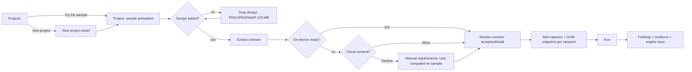
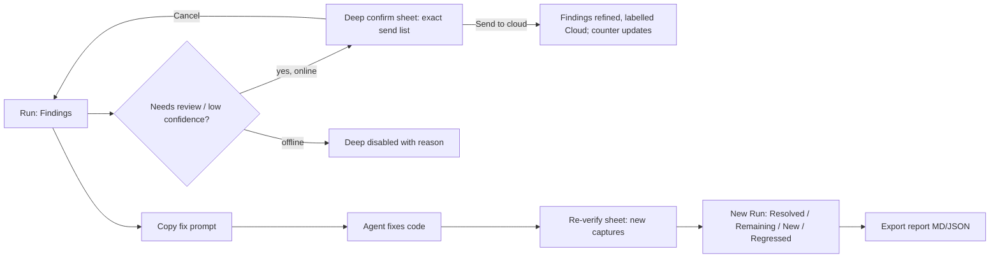

# ConformUI — Design brief

## Problem & goal
AI coding agents build pages that look right next to their design but are not: a CTA 40% too narrow, a missing illustration, a flattened heading hierarchy, a mobile nav that overlaps the hero. "Fix what looks wrong" gives an agent nothing to act on. ConformUI turns the design into a reviewed list of checkable Requirements (the Contract), verifies captures against it with numbers from a deterministic engine, and hands the failures back as a paste-ready Fix prompt, then proves the fix with Re-verify. The UI's job: get from a dropped design to a trustworthy, measured Finding in as few steps as possible, and make the provenance of every claim visible.
Success metrics: sample Findings reachable in 2 clicks (PRD M-13) · every Requirement/Finding/trace row shows its Engine (M-04) · Re-verify reads "6 resolved, 1 remaining" on the sample (M-02) · axe zero serious/critical on every route, light and dark (M-11).

## Users
| Profile | Context | Top jobs | Top frustration |
|---|---|---|---|
| Solo dev with a coding agent (primary) | Desktop Chrome, 1440–1920 px, agent in another window, iterating on one page | Know objectively what is off · tell the agent precisely · confirm the fix | Tools that say "looks different" without numbers, or that ship the design to a cloud they didn't choose |
| Agency lead | Reviews several AI-built pages before client hand-off; NDA designs | Fast acceptance pass · hand-over report · keep designs private | Visual-regression tools that compare to the last build, not the design |
| Mobile reviewer | Android phone, installed PWA, shares a screenshot in | Add a capture · read Findings · copy the Fix prompt | Desktop-only tooling; dishonest "on-device" claims |

## Constraints
- Platforms: installable PWA; desktop-first, reflows to 320 px and 200 % zoom; Android share target (P1).
- A11y: WCAG 2.1 AA (SPEC §5.5) + 2.2 target size 44 px; never colour alone (§5.3); one h1 per route; Findings list keyboard operable; Run completion announced.
- Locale: English only.
- Tech: React 19 + Vite 8 + Tailwind v4 `@theme`; inline SVG icons; no UI kit. Prototype is static HTML/CSS/JS shaped to port 1:1.
- Brand: logo `docs/brand/logo.svg` (straight-segment C/U/I stroke mark); tokens fixed by SPEC §5.2 (brand `#2563EB`/`#60A5FA`, five semantic pairs, `diff` magenta overlay only); system UI sans + mono; 4 px scale; radius 10.
- Domain rules: not a chatbot — no free-text chat input anywhere; every cloud send behind an explicit sheet listing what is sent; Cancel is default focus on cloud sheets; copyable IDs/selectors; errors name the code and what was kept.

## Information architecture
- Header (every route): logo + ConformUI · Engine status pill · Privacy counter · Offline pill (when offline) · nav: Projects, Snippet, Settings
- Projects `/`
  - Project `/p/:id` — stepper Design → Contract → Captures → Run → Fix → Re-verify
    - Contract `/p/:id/contract`
    - Run `/p/:id/run/:runId` (`?f=` Finding)
    - Compare runs `/p/:id/compare?a=&b=` (P1)
- Snippet `/snippet`
- Settings `/settings` (Engine, Mode, Cloud consent, Privacy, Data, About)
- Onboarding (first run overlay route `/welcome`)
- Sheets: New project, Add capture (also share-target entry), Paste snapshot, Cloud consent, Deep Analysis confirm, Re-verify, Export, Delete project, Clear all data, Add/edit requirement, Dismiss finding (P1)

Navigation model: thin top bar for the 3 global destinations + a persistent project stepper inside a Project. Why: only three global places; the real navigation is the workflow, and the stepper always names the next action (research: "state what is outstanding").

## Flows

```mermaid
flowchart LR
  S[Settings / Engine panel] --> ST{Device status}
  ST -->|downloadable| DL[Download model: progress] --> OK[Ready]
  ST -->|flag missing| STEPS[Copy enable steps → relaunch] --> DL
  ST -->|not desktop Chrome| CL[Cloud per project after consent]
  S --> RVK[Revoke project consent] --> ASK[Next extract asks again]
  S --> CLR[Clear all data: confirm naming scope]
```

## Screen inventory
| Screen | Purpose | Key components | States | Priority |
|---|---|---|---|---|
| Onboarding | Explain loop, engines, privacy; start sample | Loop diagram, EngineBadge ×3, privacy table | default, canDownload | P0 |
| Projects | Pick or start a project | ProjectCard, SummaryCounts, viewport chips | empty, list, sample tag, offline | P0 |
| Project | Inputs per viewport + next action | Stepper, DropZone, SnapshotStatus, EnginePanel compact, RunHistory | new/no design, design only, ready to run, has runs, invalid snapshot, image error | P0 |
| Contract | Extract, review, lock | ExtractProgress, RequirementTable, DesignCanvas with regions, AI-vs-verified panel, Add requirement | no design (disabled), extracting, review, locked, consent needed, AI bad output | P0 |
| Run | Findings + evidence + trace | SummaryBar, FindingsList, FindingDetail, ComparisonView, MeasurementTable, EngineTrace, Passing/Not checked lists | running (progress per stage), complete, re-verify deltas, offline, deep refined, pre-computed | P0 |
| Compare runs | Two Runs side by side per Requirement | RunPicker ×2, ChangeTable | default | P1 |
| Snippet | Get DOM snapshot | CodeBlock, Copy, 3 steps, privacy line | default, copied | P0 |
| Settings | Engine, mode, consent, privacy, data | EnginePanel full, ModeRadio, ConsentList, PrivacyCounter, Danger zone | each device status, offline, no consents | P0 |
| Sheets | Consent, Deep confirm, Re-verify, Export, New project, Add capture, Paste snapshot, Delete, Clear data, Dismiss | Sheet, SendList, focus trap | default, error, cap reached | P0 (Dismiss P1) |
| Error / not found | Route boundary | StateNotice | — | P0 |

## Content model
| Entity | Fields shown | Sample values |
|---|---|---|
| Project | name, viewports, last run, counts, sample tag, cloud usage | "Sample landing page" · Desktop 1440, Mobile 390 · 25 Nov 2026 14:32 · 6 fail, 1 review, 11 pass |
| Requirement | ID, category, label, check type, statement, condition, region, engine, origin | `R-D-04` · Size · Explicit · Measured · "Primary CTA width matches the design" · "width within ±8% of 220 px" |
| Inferred requirement | viewport-prefixed ID | `I-M-01` · Responsive · "Layout fits at 390 px: no horizontal overflow, no overlap, no clipped text" |
| Run | id, created, viewports, summary, contract version, trace | `run_7f3a…c21e` · Contract v1 (locked) · 1.8 s measured |
| Finding | severity, status, confidence, engine, statement, measurements (design/actual/Δ/source), selector, fix, condition | Major · Fail · High · Measured · "Primary CTA is 132 px wide vs 220 px in the design (−40%), measured from DOM snapshot." · `main .hero a.btn-primary` |
| Trace step | step, engine, duration, bytes sent | "Extract contract · On-device · 6.4 s · 0 B" / "Deep Analysis · Cloud · 3.1 s · 412 KB" |
| Engine status | device, headline, steps | "On-device model ready — first pass stays on this device" |

## Design intent
1. Who/doing: a developer at a desktop, agent in the next window, deciding what to tell it next.
2. Hero moment & main action: the Finding detail — design crop and capture crop side by side with a dimension line reading "220 px → 132 px · −40% · DOM snapshot" — then **Copy fix prompt**.
3. Baseline kept: list-left / evidence-right split, status summary bar atop the run, code-block with copy, top bar + workflow stepper.
4. Deviation: provenance is first-class, not a footnote — every row carries a worded Engine badge and every number carries its source tag; Explicit vs Inferred and Needs review/Not checked are visually distinct shapes (dashed), not just colours. Why: research found no tool does this; it is the product's trust argument.
5. Direction: a calm measuring instrument — quiet neutral chrome, mono numerals, colour reserved for status and the one primary action.
6. Signature: the caliper — dimension lines with end ticks, delta callouts and region outlines on ComparisonView and the Contract canvas, echoed by the logo's straight-segment geometry. Everything else (cards, tables, settings) stays plain.
